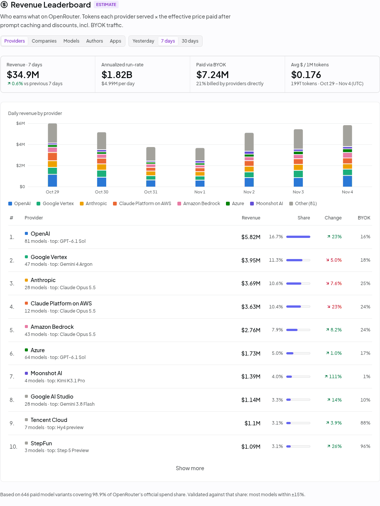
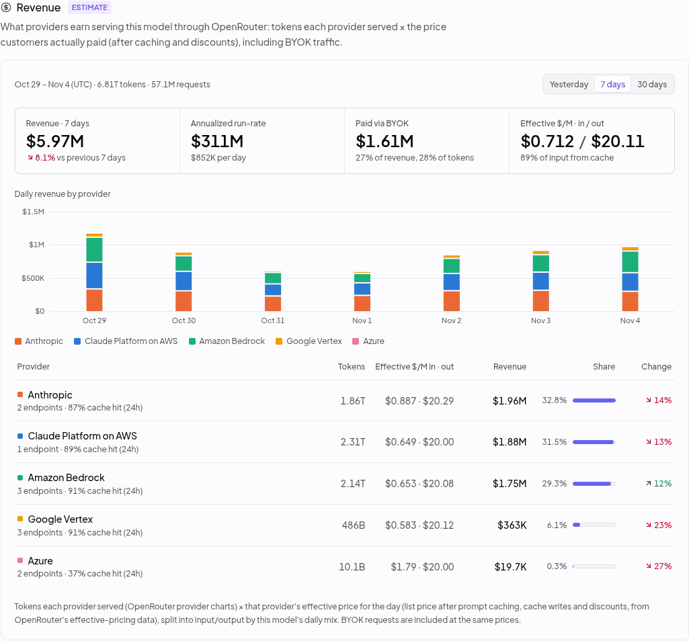
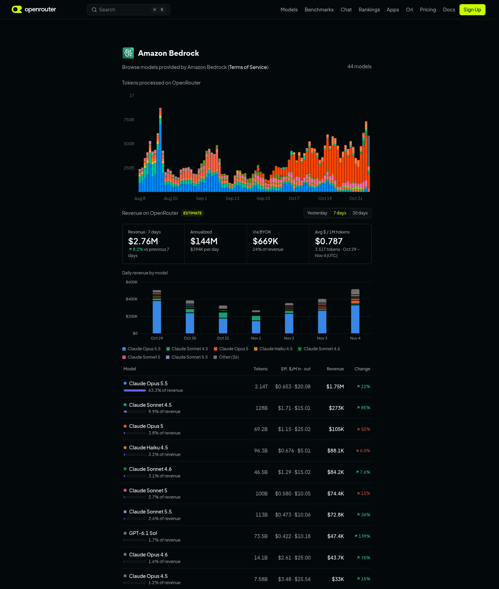
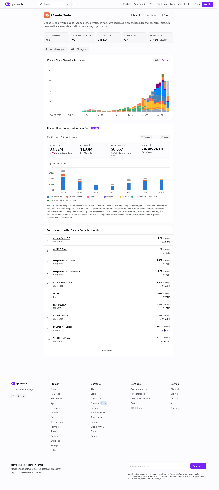

# OpenRouter Cashflow

A Chrome extension that shows **who earns what on OpenRouter**. It adds estimated revenue in USD for hosting
providers, models, model authors and apps directly into openrouter.ai, so the numbers are in front of you while
you browse the site.



## What you get

| Page | Added |
|---|---|
| `/rankings` | A **Revenue Leaderboard** section after the LLM Leaderboard. It groups revenue by Providers, Companies (e.g. Vertex + AI Studio → Google), Models, Authors or Apps, over yesterday, 7 days or 30 days. It shows totals, annualized run-rate, the BYOK share, a daily stacked chart and a ranked table with change vs the previous period. Rows in the LLM Leaderboard and Top Apps also get a `$` figure. |
| Model page (`/anthropic/claude-opus-5.5`) | A **Revenue** card in the header grid and a **Revenue** section after Pricing. The section shows revenue per hosting provider, effective $/M, cache-hit rate, a daily chart and change. Rows in the Apps list show estimated app spend on the model. A nav entry is added too. |
| Provider page (`/provider/deepinfra`) | Revenue on OpenRouter: totals, a daily chart by model and models ranked by revenue. Every model card shows the provider's revenue on that model. |
| Author page (`/anthropic`) | Revenue across all hosts of the author's models, plus a figure on every model card. |
| App page (`/apps/claude-code`) | Estimated spend: a header stat, a spend card with daily spend by model, and spend per row in "Top models used". |

Hover any figure to see the breakdown. Everything follows OpenRouter's light and dark themes and works down to
phone width. The new sections are also listed in each page's own section navigation: the desktop sidebar and the
phone/tablet section sheet. Choosing an entry jumps to it like OpenRouter's own entries do.

| Model page | Provider page (dark) | App page |
|---|---|---|
|  |  |  |

More in [All views](#all-views).

## Install

```sh
npm install
npm run build
```

Then open `chrome://extensions`, turn on **Developer mode**, click **Load unpacked** and pick the `dist/`
folder. Open <https://openrouter.ai/rankings>.

## How the numbers are computed

Multiplying list price by tokens doesn't work. About 80–95% of prompt tokens on popular models are cache reads
that cost around 10× less, so that approach overstates revenue several times. Instead, for every model, provider
and UTC day:

```
revenue = tokens the provider served that day          (stats/provider-token-chart, exact, incl. BYOK)
        × the provider's effective $/M that day         (stats/effective-pricing: what customers actually
                                                         paid after prompt caching, cache writes and discounts)
          split into input/output by the model's daily prompt/completion mix   (stats/model-activity)
```

- **BYOK traffic is included**: customers bring their own key and pay the provider directly. Its share is shown
  separately everywhere.
- **Fallbacks.** When OpenRouter publishes no effective price (e.g. batch variants), the list price is used. Cached
  input is priced at the cache-read rate, using the model's own share of cached tokens that day.
- **Free models** earn $0: free variants, and models whose endpoints charge nothing in any unit (e.g. stealth
  models, including ones whose free stealth period has ended and that have no price any more). Rerank models, whose per-token price OpenRouter only shows in its display pricing, are priced from it.
- **No price at all.** A model that still has traffic but no effective or list price any more (no provider lists
  it) is shown as "price unknown", named, and left out of revenue totals.
- **Apps.** An app's daily tokens per model (from its usage chart) × that model's effective price that day. The
  chart files a model's free-variant traffic under the same name, so those tokens are split by OpenRouter's own
  paid/free mix for the model that day (never more paid tokens than the paid variant served; if that mix can't be
  loaded, the page says so and paid tokens are capped at the paid variant's total). Tokens
  in "Others" or on models with no price are priced at the app's average for that day; when most of a window is
  priced that way, the spend is marked as mostly estimated.
- **Not covered:** non-token pricing (per-second video and audio, per-image). It is about 1% of OpenRouter spend.

**Validation.** OpenRouter publishes each model's *share* of billed spend (`rankings/models?metric=spend`, which
excludes BYOK). Normalised the same way, our bottom-up estimates match it: over the top 40 models for the last
7 days, the median ratio is 0.97 and 38 of 40 models fall within ±15%. Re-run it any time:

```sh
node --experimental-strip-types scripts/validate.ts 40 7d
```

For reference, in early November 2026 that put OpenRouter at roughly **$27M/week billed plus about $7M/week via
BYOK**.

### Caveats

- These are estimates built on OpenRouter's **undocumented frontend API** (`/api/frontend/v1/...`). It can
  change or break without notice.
- Revenue here means what customers pay for inference. It does not cover how that money is split between
  OpenRouter's fee, the host and the model author.
- Per-provider BYOK amounts are estimated from the model-level BYOK share.

## How it works

- A content script on `openrouter.ai` waits for React to hydrate, then mounts small Preact islands next to the
  site's own elements. It copies the site's class names where it can and builds on the site's CSS variables
  everywhere else. A `MutationObserver` re-attaches the islands when the SPA re-renders or navigates.
- All requests go through one priority queue (8 concurrent). Background work, such as the market-wide leaderboard
  that loads models in order of spend share, may use at most 5 of the slots. Whatever is on screen can always
  start right away.
- Derived per-model records are cached in `chrome.storage.local` until the next UTC day's data. Revisits are
  instant and request volume stays low.
- **The page doesn't jump under you.** Our blocks appear and fill in after OpenRouter's page has rendered. Every
  change we make keeps whatever you are reading at the same place on screen. Jumps to a section (sidebar, section
  sheet, in-page links) land exactly where they would without the extension. Back/Forward and reload return you
  to the same spot.
- **Your choices stick.** The Revenue Leaderboard's grouping, time window and "Show more", the model tables'
  "Show more" and the time window are kept per browser tab (`sessionStorage`). Back and reload show the same view.
- Failures are shown as failures:
  - If OpenRouter's stats can't be loaded, you see an error, never a confident `$0`.
  - Models that fail to load are left out of totals, and the footnote says how many.
  - Nothing from a failed load is cached.

## Performance

Measured on 5 Nov 2026 in headless Chromium at 1440×1000, with the day's data already cached (normal browsing).
Each page was loaded with and without the extension. Long tasks are main-thread tasks over 50 ms.

| Page | Long tasks (without → with) | Long-task time | Extension's own work (total / longest slice) | JS heap |
|---|---|---|---|---|
| `/rankings` | 7 → 7 | 1631 → 1322 ms | 125 ms / 50 ms | 104 → 119 MB |
| `/anthropic/claude-opus-5.5` | 6 → 6 | 627 → 591 ms | 59 ms / 28 ms | 80 → 69 MB |
| `/provider/deepinfra` | 6 → 6 | 1330 → 1282 ms | 12 ms / 5 ms | 78 → 79 MB |
| `/anthropic` | 3 → 4 | 530 → 556 ms | 55 ms / 49 ms | 144 → 147 MB |
| `/apps/claude-code` | 4 → 4 | 1028 → 1009 ms | 82 ms / 27 ms | 79 → 81 MB |

The extension adds at most one long task per page; differences in long-task time are within run-to-run noise.
A page typically makes 13–30 requests to OpenRouter's API. The exception is the first time the Apps grouping is
opened, which loads the top 20 apps (~90). The market-wide data behind `/rankings` is loaded once per UTC day and
then served from the cache. Re-measure with `node scripts/perf.mjs` (see the script for the profile it uses).

## Testing

- **Unit tests** (`npm test`) cover the revenue model: effective vs. list pricing, cache reads, free
  models, unit-priced endpoints, app spend splits, and date and number formatting.
- **Browser regression suite** (`scripts/verify.mjs`) drives the live openrouter.ai in Chromium with the built
  extension. It has 20 suites and 210 checks covering:
  - figures and periods, layout from 320 px to desktop, light and dark themes;
  - keyboard and screen-reader behaviour, section navigation (sidebar, phone menu and section sheet);
  - reading position during loading, jumps, Back/Forward and reload;
  - sticky controls, error and outage states (simulated by blocking OpenRouter's API).

  It needs network access:

  ```sh
  node scripts/verify.mjs warmup   # load the market once into a reusable browser profile
  node scripts/verify.mjs all      # or one suite: main | layout | errors | nav | a11y | data | outage | r7 … r17
  ```

- **Review.** The UI went through 17 rounds of independent, adversarial UX reviews of `/rankings`, model pages,
  and provider/author/app pages, plus code reviews. Every finding was fixed and got a regression check (the `r7`…`r17`
  suites).

## All views

Captured with `node scripts/gallery.mjs` (5 Nov 2026 data).

### `/rankings`

| Providers · 7 days | Companies · 7 days |
|---|---|
|  |  |
| **Models · 30 days** | **Authors · 7 days** |
|  |  |
| **Apps · 7 days** | **Providers · yesterday** |
|  |  |
| **Figures in OpenRouter's LLM Leaderboard** | **Figures in Top Apps** |
|  |  |
| **Breakdown tooltip** | **Chart tooltip** |
|  |  |
| **Dark theme** | |
|  | |

### Model pages

| Header card | Revenue · 7 days |
|---|---|
|  |  |
| **Revenue · 30 days** | **App spend in OpenRouter's Apps list** |
|  |  |
| **Provider tooltip** | **Dark theme** |
|  |  |
| **Many providers** (`/moonshotai/kimi-k3`) | **Batch variant** (list-price fallback) |
|  |  |
| **Free variant** | |
|  | |

### Provider, author and app pages

| Provider (`/provider/deepinfra`) | Provider, dark (`/provider/amazon-bedrock`) |
|---|---|
|  |  |
| **Author (`/anthropic`)** | **App (`/apps/claude-code`)** |
|  |  |
| **App by URL** | **App, dark** |
|  |  |

### Phones

| `/rankings` | Section sheet on `/rankings` | Model page | Section sheet on a model page | Author page |
|---|---|---|---|---|
|  |  |  |  |  |

## Development

```sh
npm run watch      # rebuild dist/ on change (reload the extension in chrome://extensions)
npm test           # revenue model unit tests
npm run typecheck
node scripts/shot.mjs /rankings --sel='#orcf-revenue' [--dark] [--full]   # screenshots with the extension loaded
node scripts/gallery.mjs   # every view above, into shots/gallery/
node scripts/perf.mjs      # main-thread cost with vs. without the extension
node scripts/verify.mjs all   # browser regression suite (run `warmup` first)
```

`scripts/shot.mjs` uses `playwright-core` with a local Chromium (`CHROMIUM=/path/to/chromium`, default `/usr/bin/chromium`).

Endpoint notes from the original research are in [`docs/openrouter-research.md`](docs/openrouter-research.md).

## License

MIT
